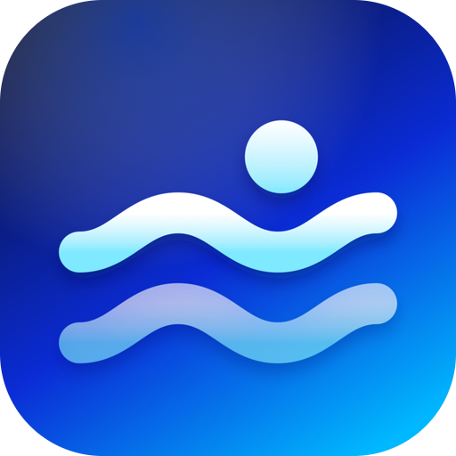
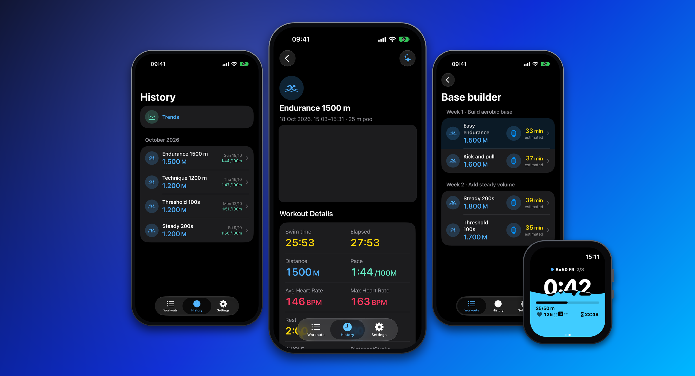
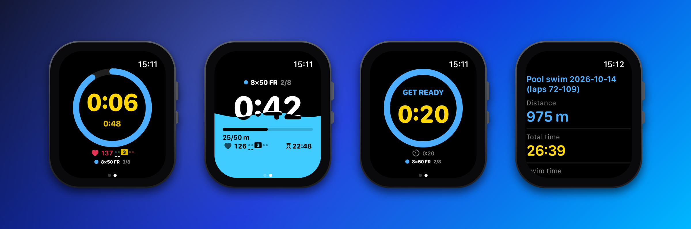
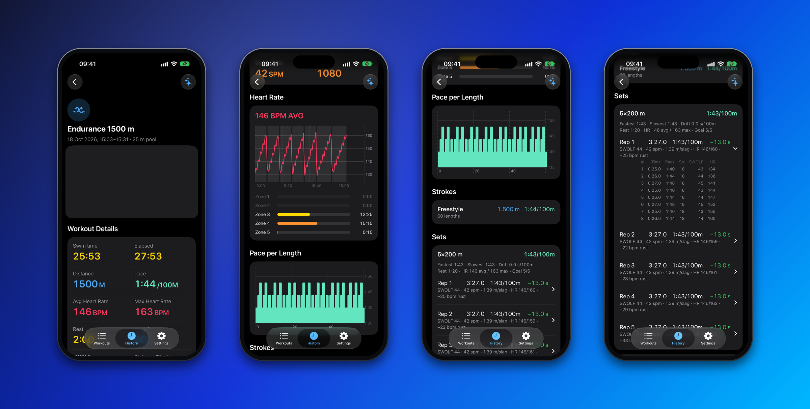
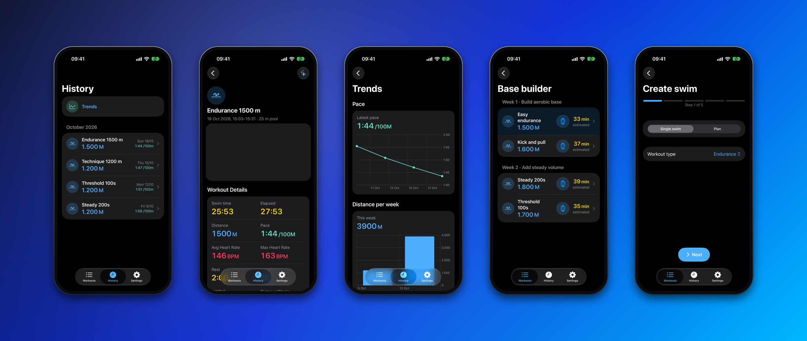
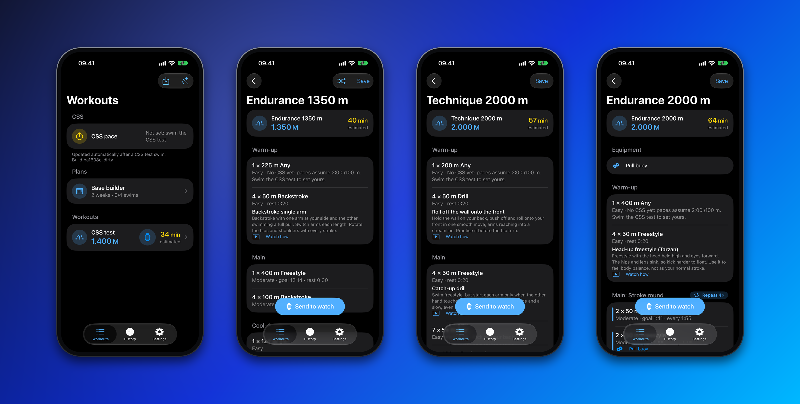
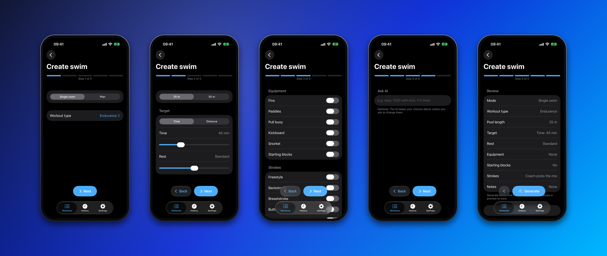
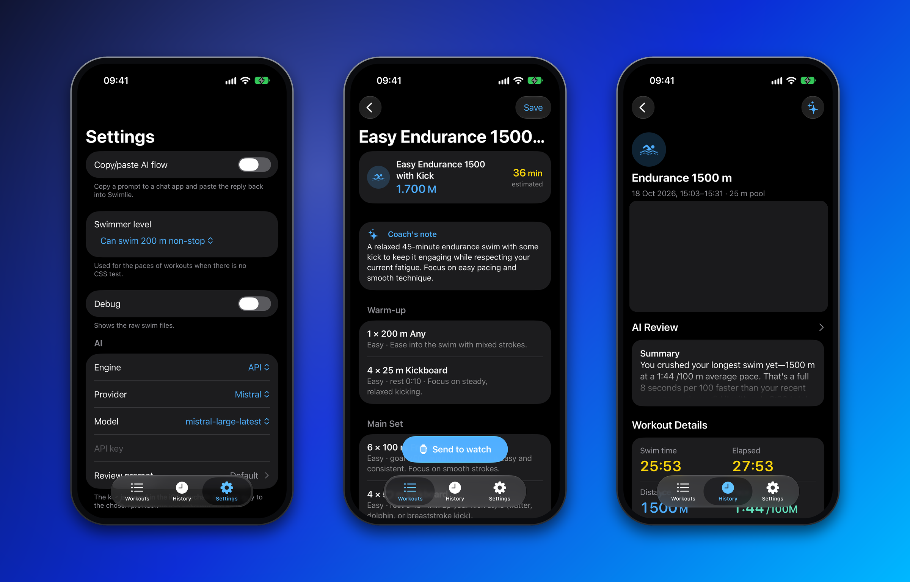

<p align="center">
  
</p>

<h1 align="center">Swimlie</h1>

<p align="center">
  <b>Open source, local-first swim workouts for iPhone and Apple Watch.</b><br>
  Build a set, swim it with a big readable clock on your wrist, review every lap afterwards.
</p>

<p align="center">
  
</p>

## On your wrist

Rep counter, rest countdown, heart rate zones and a progress fill you can read through goggles.

<p align="center">
  
</p>

See [ARCHITECTURE.md](ARCHITECTURE.md): Rust owns all data and logic, Swift only does UI and Apple APIs.


## Learn from every swim

The details page is where you see how you did: the route to the pool, heart rate and zones, pace per length, strokes, and every set with each rep, rest, SWOLF, stroke rate and a lap-by-lap breakdown.

<p align="center">
  
</p>

## On your iPhone

Plan workouts and multi-week plans, send them to your watch, and look back at pace, heart rate and distance per week.

<p align="center">
  
</p>

## Workouts

Generate a swim from your goal, pool and equipment: warm-up, drills with a cue and video, a main set and a send-to-watch button.

<p align="center">
  
</p>

## Build your own swim

Five quick steps: type and pool, time or distance, gear and strokes, an optional note for the AI, then review and generate.

<p align="center">
  
</p>

## AI, on your terms

Bring your own key: Mistral, OpenAI, Anthropic, Gemini, OpenRouter or any OpenAI-compatible endpoint. The key lives in the iOS Keychain and goes only to the provider you chose. Your swims stay on your devices; a summary leaves the phone only when you ask for a review.

- **Generate with AI:** describe the swim you want and the AI writes the whole workout, validated against the public [workout schema](schema/workout.schema.json).
- **Review with AI:** a plain-language review of a swim from its laps, pace and heart rate, in your app language and compared with your previous swims.
- **No key? No problem.** Copy a ready-made prompt to any chat app and paste the reply back, or let the built-in coach generate workouts offline.

<p align="center">
  
</p>

## Layout

| Path | What |
|---|---|
| `core/` | Rust crate: all data handling and calculations, exported to Swift with UniFFI |
| `xtask/` | Repo automation: builds, tests, devices, screenshots, lint (`cargo xtask`) |
| `schema/` | Workout JSON schema (generated from `core`), example and AI prompt |
| `apple/` | XcodeGen spec, iOS app, watchOS app, `SwimlieCore` Swift package |
| `docs/` | README images and recorded AI replies |

## Develop

```sh
cargo test               # core tests
cargo xtask lint         # formatting, strict clippy, file length: what CI runs
```

See [CONTRIBUTING.md](CONTRIBUTING.md) for the workflow and [ARCHITECTURE.md](ARCHITECTURE.md) for how the pieces fit.

## Build for your device

Needs full Xcode, `brew install xcodegen`, rustup. Your iPhone and paired watch must be in developer mode and trusted.

```sh
cp .env.example .env     # set SWIMLIE_TEAM_ID to your Apple developer team id
cargo xtask devices      # copy your iPhone's identifier into .env as SWIMLIE_PHONE
cargo xtask install      # builds and installs iPhone app + watch app
```

Other commands: `cargo xtask test` (core + simulator tests), `cargo xtask sim` (run in the watch simulator), `cargo xtask` (full list).

## Refresh the images

The pictures above are rendered from real screenshots, so they can be updated at any time:

```sh
cargo xtask shots      # captures iPhone and Watch screenshots from the simulators
                       # (AI replies are recorded once with API_KEY and AI_PROVIDER from .env into docs/shots/*.txt and replayed after that, so no tokens are spent)
cargo xtask mockups    # frames them into docs/hero.png, phones.png, details.png, workouts.png, builder.png, ai.png, watch.png, icon.png
```
